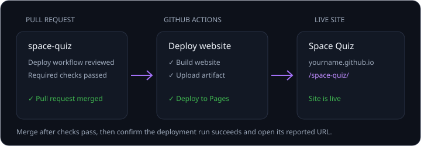

Space Quiz を公開し、誰でもアクセスできるようにします。Copilot はワークフローを準備してデプロイを案内できますが、変更をレビューし、サイトが公開されたことを確認するのはユーザーの役割です。

このレッスンでは、次のことを行います。

- Copilot に GitHub Pages のデプロイを構成するよう依頼します。
- マージ前にワークフローと pull request をレビューします。
- デプロイを追跡し、公開されたサイトを確認します。

## シナリオ

Space Quiz はすでに GitHub リポジトリにありますが、訪問者が簡単に試せる方法が必要です。1 ファイルのサイトを GitHub Pages で公開すると、サーバーやランタイム依存関係を追加せずに、公開 URL からアクセスできるようになります。

## Copilot にサイトのデプロイを依頼する

`space-quiz` の Copilot アプリ セッションで、次のプロンプトを送信します。

```plaintext
このリポジトリで GitHub Pages を有効にしてください。必要に応じて Web サイトをビルドし、GitHub Pages にデプロイする GitHub Actions ワークフローを作成してください。README がまだない場合は、アプリの説明とローカルでの実行方法を記載した README を追加してください。これらの変更で pull request を作成し、必須チェックに合格した後にマージしてください。デプロイが成功するまで監視し、公開サイトの最終 URL を報告してください。Pages の有効化やマージの権限がない場合は、何を承認または実行すればよいか正確に説明してください。サイトが公開されるまで、成功したと報告しないでください。
```



> [!WARNING]
> このプロンプトでは、エージェントに pull request の作成とマージ、リポジトリの Pages 設定の変更を依頼します。続行する前に、差分、デプロイ権限、GitHub の承認プロンプトを確認してください。

## ワークフローをレビューしてデプロイを確認する

1. リポジトリに README がまだない場合に限り、README が追加されていることを確認します。
2. ワークフローのビルドとデプロイの手順を含め、pull request の変更をレビューします。
3. 必須の pull request チェックに合格した後にのみマージします。
4. GitHub Actions のデプロイ実行が成功するまで追跡します。
5. 報告された URL を開き、Space Quiz が読み込まれることを確認します。

エージェントが Pages を有効にできない、または pull request をマージできない場合は、エージェントが示す具体的な手順に従います。デプロイが成功し、公開サイトが読み込まれるまでは、作業を完了とみなさないでください。

## まとめと次のステップ

Space Quiz が公開サイトとして利用できるようになりました。エージェントの報告だけに頼らず、デプロイを確認できました。[レッスン 13: レビューと次のステップ][next-lesson]に進みます。

[next-lesson]: ../13-review/
